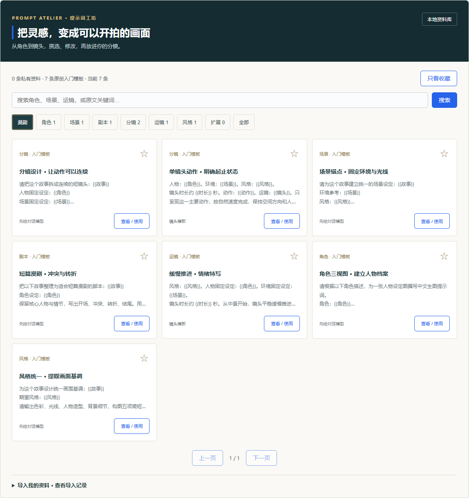

# AI 漫剧工作台

把故事整理成分镜，挑选提示词，在你使用的生成平台制作素材，再回到本地合成视频。

**0.6 本地升级**：稳定项目 ID、保存与版本恢复、明确素材对应、独立导出与失败校验，可编辑分镜、复制导演指令及粘贴结果导入。数据兼容、迁移和操作说明见 [本地升级说明](docs/local-upgrade.md)。

工作台采用 **Python 本地服务 + 原生 HTML/JavaScript + FFmpeg**，保留对话式创作访谈、角色与环境设定、分镜生成和项目合成流程。新增提示词工坊，把散落在文档、表格中的资料变成可搜索、可编辑、可直接复制的创作素材。

## 能做什么

- **故事到分镜**：五轮创作访谈，生成连续短镜头，统一记录角色与环境锚点。
- **提示词工坊**：角色、场景、剧本、分镜、运镜、风格分类；全文搜索、收藏、分页与原文来源。
- **本地资料导入**：读取 Word、文本和表格，表格按行拆成条目，同内容去重，显示未完成或无法读取的文件。
- **模板到镜头**：填写变量或带入当前角色、环境与动作，预览修改后应用到指定镜头，支持撤销上次替换。
- **生成与合成**：逐镜复制到豆包等平台，下载视频后按编号放入项目文件夹，由 FFmpeg 合成。

仓库附带 **7 条项目原创入门模板**。自行导入的资料留在本机，不包含在公开仓库。项目提供创作辅助；具体平台的免费额度、生成能力、角色一致性与最终成片质量需实际验证。



## 快速开始

需要 Windows、Python **3.10 或更新版本**。视频合成另需 FFmpeg，并将其加入 PATH。提示词库和默认分镜扩写使用 Python 标准库，不需要模型 API Key。

```powershell
git clone https://github.com/shichabg/AI-ManJu.git
cd AI-ManJu\Novel2ComicDrama
python workbench_server.py
```

也可以双击 `Novel2ComicDrama/start_workbench.bat`。服务只监听 `127.0.0.1`，自动在浏览器打开本地工作台，关闭启动窗口即可停止服务。

## 导入提示词

1. 下载资料并解压到一个具体的本地文件夹。
2. 在「提示词工坊」展开「导入我的资料」，输入文件夹的完整路径，点击「导入 / 更新」。
3. 查看读取文件数、去重条目数与待处理清单。下载完成后再次导入即可更新。
4. 按创作阶段或关键词查找资料，点击「查看 / 使用」。完整系统指令应先给对话模型，拿到输出后再作为镜头素材；表格条目也需要按实际故事修改。

| 格式 | 支持方式 |
| --- | --- |
| TXT、MD | 完整文本；支持 UTF-8、带 BOM 的 UTF-16、GB18030 |
| DOCX | 正文段落与表格内的文字，保留顺序与换行；不提取图片内文字 |
| CSV、XLSX | 按非空行拆分，保留列名、工作表名和原行号；不执行公式或宏 |
| PDF | 安装可选依赖 `python -m pip install pypdf` 后读取文本层；扫描件暂不支持 OCR |
| 旧 DOC | 先转换为 DOCX，或使用下面的本地 Word 文本提取脚本 |
| 压缩包、下载临时文件 | 列入待处理；请解压或下载完成后重新导入 |
| 图片、视频等 | 跳过并统计；不自动反推提示词 |

单文件读取限制为 32 MB。Word/XLSX 的单个 XML 部件也受此限制。无法读取的文件不会被当成成功导入。

如果电脑安装了 Microsoft Word，可在 `Novel2ComicDrama` 中运行：

```powershell
.\scripts\convert_legacy_docs.ps1 -SourceFolder 'D:\提示词资料'
```

脚本以隐藏、只读、禁用宏的方式打开旧 DOC，将正文文本保存到私有目录，不修改原文件。运行后回到工作台重新导入同一资料目录。文本提取不包含图片、排版或视觉信息；更换源文件后需重新提取。

导入目录保存在 `data/private/library.json`，旧 DOC 文本保存在 `data/private/extracted/`，收藏保存在 `data/private/preferences.json`，重启工作台后继续保留。这些路径已加入 `.gitignore`。导入支持**多资料包并存、文件指纹增量更新、后台进度与撤销**；失败或丢失的来源保留已读条目。公开资料之前请确认传播授权，并挑选、审阅要发布的内容。

## 制作一部漫剧

1. 填写故事与角色描述，点击「开始创作」，回答地点、时间、情绪、创意与画面重点。
2. 生成分镜后，可从提示词库选择模板，填入角色与当前镜头，编辑后应用。应用只改变所选镜头的提示词，角色、环境设定和其他镜头继续保留；刷新后也可撤销上次替换。
3. 复制分镜提示词到你使用的模型。人物设定图、参考图与场景锚点应在生成时一起使用，按平台实际能力调整。
4. 确认分镜，创建专属项目文件夹，将生成视频按 `1.mp4`、`2.mp4` 等编号放入。
5. 刷新视频并合成，打开成片审看。默认保留素材自带音轨，可加入本地背景音乐。

重置工作台不会删除已生成的项目文件。缺失镜头或重复备选会阻止导出；手动确认镜头 ID 对应关系后才能继续。每版成片位于当前项目的独立任务目录。

## 项目结构

```text
Novel2ComicDrama/
├── start_workbench.bat
├── workbench_server.py          # 本地 HTTP 服务、状态与合成
├── workbench_ui/
│   ├── index.html               # 原工作台与分镜流程
│   ├── prompt-library.js        # 搜索、编辑、收藏、应用与撤销
│   └── prompt-library.css
├── modules/
│   ├── prompt_library.py        # 文档解析、分类、去重与私有目录
│   ├── browser_workflow.py      # 原分镜与项目流程
│   ├── video_composer.py        # FFmpeg 合成
│   └── ...                     # 保留原有角色管理与旧管线
├── data/
│   ├── prompts/builtin.json    # 公开原创模板
│   └── private/                # 本机资料，不提交
├── scripts/convert_legacy_docs.ps1
├── tests/
└── output/                     # 本机输出；历史已跟踪样例保留
```

## 开发与验证

```powershell
python -B -m unittest discover -s Novel2ComicDrama/tests -v
```

测试覆盖 Unicode/GBK 文档、表格行号、去重与更新、旧 DOC 文本匹配、未完成文件提示、接口校验、原分镜流程和替换撤销后的保存。CI 在 Windows 和 Linux 的 Python 3.10/3.12 上运行这些测试。实际视频生成、FFmpeg 成片效果和第三方平台额度需要另外验证。

隔离测试或迁移时可设置 `AIMANJU_OUTPUT_DIR` 和 `AIMANJU_PRIVATE_DATA_DIR`，分别指定输出目录与私有资料目录。自定义目录应放在仓库外，或自行加入 Git 忽略规则。

默认扩写在本地完成。原有的 OpenAI 兼容扩写接口仍支持 `EXPAND_LLM_API_KEY`、`EXPAND_LLM_BASE_URL`、`EXPAND_LLM_MODEL` 环境变量，未配置或调用失败时回退到内置规则。凭据只放在本地环境，不提交到仓库。

旧的 `Novel2ComicDrama/main.py` CLI 管线继续保留。贡献方式见 [CONTRIBUTING.md](CONTRIBUTING.md)，版本变化见 [CHANGELOG.md](CHANGELOG.md)。当前未新增开源许可证；资料传播授权与项目许可证应由作者确定。
